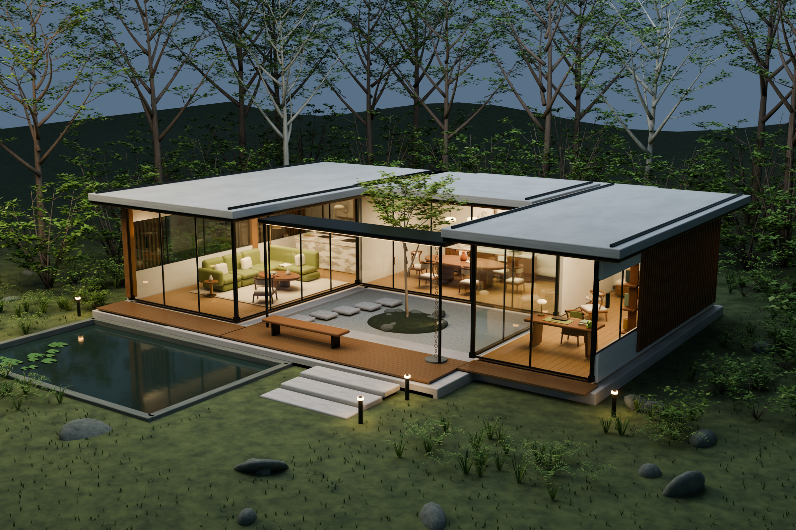

# Morrow House Studio

## 모델 미리보기

Morrow House 원본 Blender 모델 렌더. 웹 앱의 실시간 3D 화면 캡처가 아닙니다.

Walk through a fictional, generated Blender dream house and arrange its furniture. The GLB is the Morrow House asset; it is not a reconstruction of a private residence.

## Run the ready-built app

Serve `dist/`: `python3 -m http.server 8000 --directory dist`, then open http://localhost:8000. No install is needed for the checked-in browser build.

## Rebuild

Node.js and npm are required. Run `npm ci`, then `npx esbuild src/app.js --bundle --format=esm --minify --outfile=dist/app.js`. Dependencies remain pinned by `package-lock.json`.

## Data and limits

Furniture arrangements are stored in browser localStorage with JSON import/export. Actual WebGL visuals, mobile input and real-device performance remain unverified. The source model and collision approximations are intended for exploration, not architectural measurement.

See `THIRD_PARTY_NOTICES.md`.
